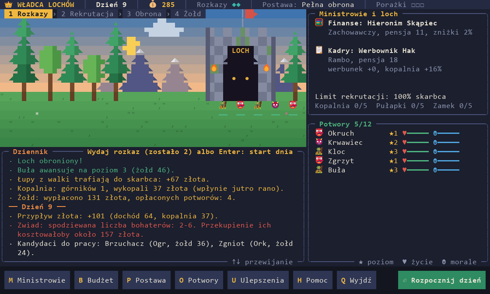
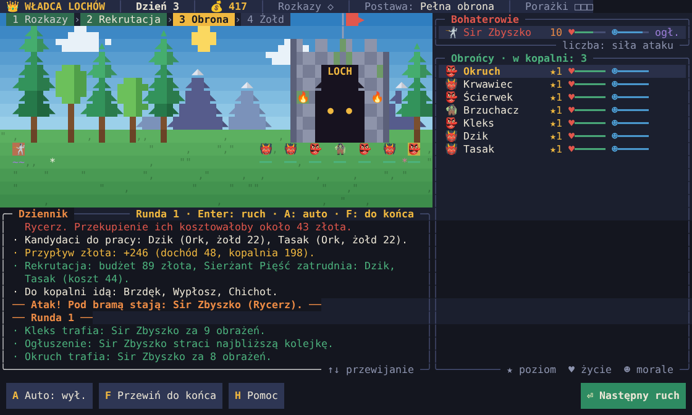
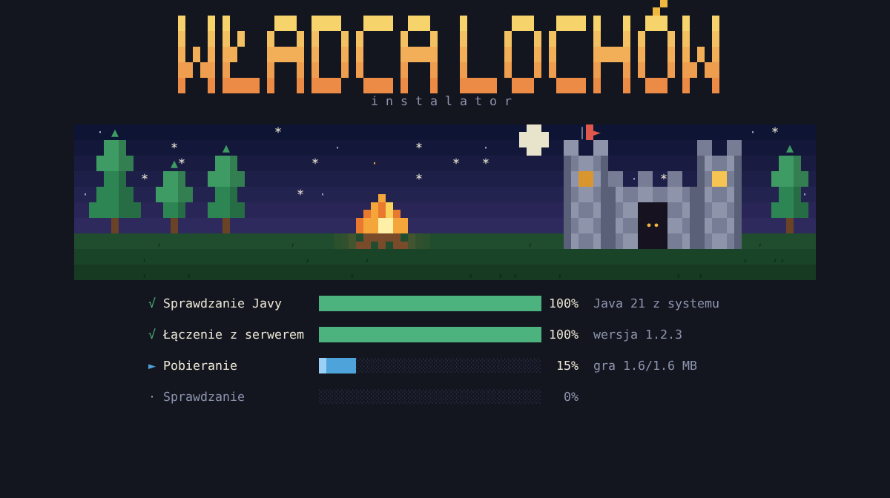

# Władca Lochów


**W zwykłych grach jesteś bohaterem, który schodzi do lochu po skarb. Tutaj jest odwrotnie:
loch jest Twój, skarb jest Twój, a bohaterowie to włamywacze.**





Obrazki to podgląd wyrenderowany poza terminalem; dokładny wygląd zależy od czcionki terminala.

## O co chodzi

Jesteś Władcą Lochów. Pod ziemią masz skarbiec pełen złota i gromadę potworów na żołdzie:
tchórzliwe gobliny z procami, twarde orki i ogry, które idą przez walkę jak czołg. Na powierzchni
krążą rycerze, łucznicy i złodzieje, którzy słyszeli o Twoim złocie. Im więcej go masz, tym chętniej
przychodzą.

Nie machasz mieczem i nie przesuwasz potworów po planszy. Ty rządzisz. Rano podejmujesz jedną albo
dwie decyzje, a potem patrzysz, jak dzień rozgrywa się sam.

Gra działa w terminalu, ale nie wygląda jak ściana tekstu: jest kolorowa sceneria, postacie, paski
życia i przyciski, które można klikać myszką.

## Jak wygląda jeden dzień

1. **Rano decydujesz.** Zwiad melduje, ilu bohaterów się zbliża. Kupić pułapki? Dać premię
   potworowi, któremu puszczają nerwy? Wymienić ministra? A może po prostu zapłacić bohaterom,
   żeby sobie poszli?
2. **Loch pracuje.** Wpływa złoto. Twoi ministrowie zatrudniają nowe potwory i wysyłają co
   trzeciego do kopalni.
3. **Bohaterowie atakują.** Potwory stają pod bramą. Walkę oglądasz ruch po ruchu albo przewijasz
   do końca.
4. **Wieczorem płacisz.** Każdy wojownik chce żołdu. Kto go nie dostanie, traci morale, a w końcu
   pakuje się i odchodzi. Na koniec dostajesz rachunek: ile złota przyszło, na co poszło i kto
   nie dożył wieczora.

Jeden dzień to kilka naciśnięć klawiszy.

## Dlaczego warto spróbować

- **Chciwość kontra bezpieczeństwo.** Złota potrzebujesz na żołd i ulepszenia, ale pełny skarbiec
  ściąga coraz groźniejszych gości. Ile odważysz się trzymać?
- **Ministrowie z charakterem.** Jeden chomikuje złoto na czarną godzinę, drugi wydaje wszystko
  od ręki. Jeden zatrudnia tylko najsilniejszych, drugi bierze, kto się nawinie. To Ty wybierasz,
  komu oddać loch.
- **Potwory mają imiona.** Zgrzyt, Purchawka i Rozpruwacz to nie liczby. Kto przeżyje walkę, staje
  się weteranem: bije mocniej, ale chce więcej złota. Strata takiego boli.
- **Nie da się wygrać, da się tylko przetrwać dłużej.** Bohaterowie z każdym dniem są silniejsi.
  Trzy przegrane obrony z rzędu i loch upada. Ile dni wytrzymasz?
- **Każda rozgrywka jest inna.** Inni kandydaci, inni bohaterowie, inne kłopoty.

## Nie musisz nic umieć

Wybierz nową grę **z samouczkiem**. Pierwszego dnia tylko patrzysz. Przez kolejne cztery dni doradca
odsłania po jednej możliwości i tłumaczy, co się właśnie stało. Pierwszy przeciwnik to jeden
niedoświadczony rycerz, z którym Twoje potwory poradzą sobie same.

## Instalacja na Windows

Wklej do PowerShella:

```powershell
irm https://raw.githubusercontent.com/MarekSpodBiedry/WladcaLochow/main/install.ps1 | iex
```



Instalator niczego nie instaluje w systemie i nie potrzebuje uprawnień administratora:

1. **Sprawdzanie Javy.** Szuka Javy 21 lub nowszej. Gdy jej nie ma, pobiera przenośną Javę
   (Eclipse Temurin) do folderu gry.
2. **Łączenie z serwerem.** Pyta GitHuba o najnowsze wydanie.
3. **Pobieranie.** Zapisuje grę w `%LOCALAPPDATA%\WladcaLochow` i tworzy skróty na pulpicie
   oraz w menu Start.
4. **Sprawdzanie.** Porównuje sumę SHA-256 pobranego pliku i uruchamia autotest gry.

Na koniec dowolny klawisz uruchamia grę. To samo polecenie służy do aktualizacji: gra przy starcie
sama sprawdza, czy jest nowsze wydanie, i pokazuje w menu przycisk „Aktualizuj”.
Odinstalowanie to usunięcie folderu `%LOCALAPPDATA%\WladcaLochow` i skrótów „Władca Lochów”.

## Pobierz i graj (Linux, macOS)

1. Zainstaluj Javę 21 lub nowszą.
2. Pobierz [wladca-lochow.jar](https://github.com/MarekSpodBiedry/WladcaLochow/releases/latest/download/wladca-lochow.jar)
   (wszystkie wersje są na stronie [wydań](https://github.com/MarekSpodBiedry/WladcaLochow/releases)).
3. Kliknij plik dwukrotnie. Gra sama otworzy okno terminala i w nim wystartuje.

Jeśli dwuklik nie działa (zależy to od tego, czy system kojarzy pliki `.jar` z Javą), otwórz
terminal w folderze z plikiem i wpisz:

```bash
java -jar wladca-lochow.jar
```

Gra szuka terminala w tej kolejności: Windows Terminal lub zwykła konsola na Windows, Terminal
na macOS, a na Linuksie między innymi GNOME Terminal, Konsole, kitty, Alacritty i xterm.
Jeśli żadnego nie znajdzie, pokaże polecenie do wpisania ręcznie.

## Budowanie ze źródeł

Wymagania: Java 21 lub nowsza i Maven.

```bash
mvn package
```

```bash
java -jar target/wladca-lochow.jar
```

Terminal musi mieć co najmniej 108 × 30 znaków, obsługiwać Unicode i emoji. Najlepiej wygląda
w terminalu z kolorem 24-bitowym (Windows Terminal, iTerm2, kitty, WezTerm, terminal VS Code,
GNOME Terminal). W pozostałych gra sama przechodzi na 256 kolorów.

Opcje:

| Opcja | Znaczenie |
|---|---|
| `--ziarno LICZBA` | powtarzalna rozgrywka: to samo ziarno i te same decyzje dają ten sam przebieg |
| `--zapisy FOLDER` | inny folder slotów zapisu (domyślnie `%LOCALAPPDATA%\WladcaLochow\zapisy` na Windows, `~/.wladcalochow/zapisy` na pozostałych systemach) |
| `--kolory 24` lub `--kolory 256` | wymuszenie trybu kolorów (to samo robi zmienna `WLADCA_KOLORY`) |
| `--bez-okna` | nie otwieraj nowego okna terminala, nawet gdy gra została uruchomiona bez niego |
| `--bez-aktualizacji` | nie pytaj GitHuba o nową wersję (to samo robi zmienna `WLADCA_BEZ_AKTUALIZACJI`) |
| `--wersja` | wypisz numer wersji i zakończ |
| `--sprawdz` | autotest bez terminala: rozgrywa kilka dni i sprawdza zapis; używa go instalator |

## Sterowanie

- **Klawiatura:** litery i Enter widoczne na przyciskach u dołu ekranu; w oknach wyboru strzałki,
  Enter, cyfry 1-9 i Esc. Strzałki góra/dół przewijają dziennik.
- **Myszka:** kliknięcie w przycisk albo w opcję okna. Sam ruch myszki niczego nie robi.

## Pierwsza gra

Przy nowej grze wybierz „Z samouczkiem”. Najpierw zobaczysz cztery krótkie strony wprowadzenia,
a potem przez pierwsze 5 dni prowadzi Cię doradca:

| Dzień | Co się pojawia |
|---|---|
| 1 | żadnych decyzji: oglądasz, jak wygląda dzień |
| 2 | Ulepszenia, 1 rozkaz dziennie |
| 3 | Postawa i pierwszy, łatwy atak (jeden słaby rycerz) |
| 4 | Potwory (premie, zwolnienia) i Budżet |
| 5 | Ministrowie, od teraz 2 rozkazy dziennie |

Na ekranie zawsze widać, w której fazie dnia jesteś (pasek nad sceną), co możesz teraz zrobić
(podpowiedź nad dziennikiem) i co oznaczają symbole (dolna krawędź listy potworów). Każdy dzień
kończy się podsumowaniem: ile złota przyszło, na co poszło i co zmieniło się w załodze.
Klawisz H otwiera pomoc w dowolnej chwili.

## Zasady w skrócie

Dzień składa się z czterech faz:

1. **Poranek.** Widzisz raport zwiadu i listę kandydatów. Wydajesz najwyżej 2 rozkazy.
2. **Dochód i rekrutacja.** Wpływa złoto, ministrowie pobierają pensje, Minister Finansów wyznacza
   budżet, a Minister Pracy zatrudnia potwory i wysyła jedną trzecią załogi do kopalni.
3. **Obrona.** Bohaterowie atakują, walka toczy się rundami (krok po kroku albo automatycznie).
4. **Wieczór.** Górnicy oddają urobek (wpłynie rano), wojownicy dostają żołd, wszyscy są leczeni.

Rozkazy Władcy:

| Rozkaz | Skutek |
|---|---|
| Ministrowie | zmiana Ministra Finansów lub Pracy; płatna, działa od jutra |
| Budżet | limit, jaką część skarbca wolno oddać na rekrutację |
| Postawa | pełna obrona, odwód (słabe morale czeka z tyłu) albo przekupstwo |
| Potwory | premia podnosząca morale albo zwolnienie |
| Ulepszenia | kopalnia, pułapki, zamek skarbca; każde ma 3 poziomy |

Gra nie ma końca: bohaterów przyciąga bogactwo, a z każdym dniem są silniejsi. Loch upada po trzech
przegranych obronach z rzędu albo gdy nie ma już ani potworów, ani złota. Wynikiem jest liczba
przetrwanych dni. Gra zapisuje się sama każdego ranka i po każdym rozkazie.

Gra ma 10 slotów zapisu i nigdy sama ich nie usuwa. Przegrana rozgrywka zostaje w swoim slocie,
a „Wczytaj” pozwala obejrzeć jej ostatni dzień. Gdy wszystkie sloty są zajęte, nowa gra pyta,
który zapis zastąpić.

Szczegółowy opis istot, ministrów i walki: [docs/Opis_gry.docx](docs/Opis_gry.docx).

## Budowa kodu

| Pakiet | Zawartość |
|---|---|
| `wladcalochow.model` | klasy z zadania: `Istota`, bohaterowie, potwory, ministrowie, `Loch`, `Skarbiec`, `Walka`, `RundaWalki`, `DzienGry` |
| `wladcalochow.model.strategia` | rozkazy, postawa, ulepszenia, raport zwiadu |
| `wladcalochow.silnik` | `Gra` (stan rozgrywki), generator zdarzeń, fabryka istot, zapis gry |
| `wladcalochow.ui` | terminal: bufor ekranu, sceneria, pulpit, okna, klawiatura i myszka |

Model nie zna terminala: zwraca zdarzenia, a interfejs je tylko pokazuje. Istoty są unikatowe
i nigdy nie są kopiowane.

## Wydawanie nowej wersji

Wydanie buduje się samo w GitHub Actions (workflow „Wydanie”): wystarczy zmienić numer
`<version>` w `pom.xml` na głównej gałęzi. Workflow uruchamia testy, buduje `wladca-lochow.jar`
i publikuje go jako wydanie `v<numer>`. Gdy wydanie o tym numerze już istnieje, nic się nie dzieje.
Można też uruchomić workflow ręcznie w zakładce Actions.

Instalator ma czytelne źródło w `narzedzia/install.zrodlo.ps1`. Publikowany `install.ps1` to ten sam
skrypt zapisany samymi znakami ASCII; po każdej zmianie źródła trzeba go odświeżyć:

```bash
python3 narzedzia/zbuduj-instalator.py
```

Ikona gry (`zasoby/ikona.ico`) to złote „WL” z bloków (inicjały gry), rysowane skryptem. Workflow dołącza ją
do wydania, a instalator ustawia na skrótach. Po zmianie wyglądu trzeba ją odświeżyć (wymaga Pillow):

```bash
python3 narzedzia/zbuduj-ikone.py
```

Podgląd samej animacji instalatora, bez pobierania i bez zmian na dysku:

```powershell
$env:WLADCA_PODGLAD = '1'; .\install.ps1
```

## Testy

```bash
mvn test
```

Testy sprawdzają zasady istot i ministrów, przebieg walki, fazy dnia, zapis gry oraz symulują
kilkadziesiąt pełnych rozgrywek z losowymi rozkazami.

Osobny test układu ekranu (`UkladEkranuTest`) przeklikuje całą grę automatem na trzech rozmiarach
okna i w skrajnym scenariuszu (pełny loch, najdłuższe imiona, atak dwunastu bohaterów). Po każdym
kroku sprawdza, że żaden tekst nie został przycięty, nic nie wyszło poza ekran i żadne przyciski
na siebie nie nachodzą.
